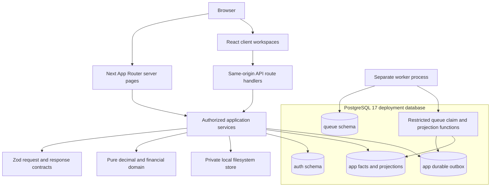
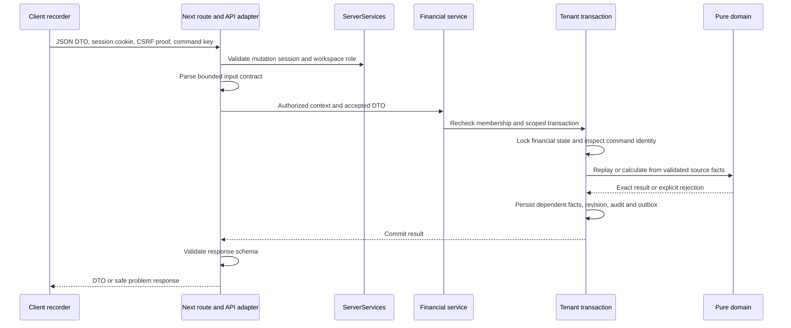

# Architecture for contributors

Reviewed **26 October 2026** against committed Checkpoint 5 `d9a96d7099a29b08bb7b055a64e17c0b7ab40e1c` and application baseline `5132900a03efabaeb307787531546987228220e7`. This chapter is **Source-reviewed**. The developer [verification record](verification.md) owns fresh execution and API/example checks; prior checkpoint results remain historical.

The existing [technical architecture](../architecture.md), [ADRs](../decisions/README.md) and [domain model](../domain-model.md) remain the design authorities. This guide explains where their boundaries appear in the delivered code. It does not replace the financial dictionaries or interpret every design proposal as implemented. Use [repository structure](repository-structure.md) for module interfaces/tests and [the domain guide](domain-and-financial-model.md) for relationships and invariants.

## The implemented runtime

Trading Journal is a modular monolith: a Next.js web/API process, a separate Node worker from the same release, PostgreSQL 17 and private local filesystem media. The supported deployment uses separate application/authentication/jobs identities against the same intended database. The web process opens separate tenant and auth pools; the worker uses the restricted jobs connection. The [deployment preflight](../../scripts/operations/production-preflight.ts) verifies the observed role/target boundary for a production deployment.

The diagram shows logical dependencies, not independent microservices. PostgreSQL schemas share the selected deployment database; the roles and pools are separate. The worker's financial path uses narrow SQL functions and generation/lease guards, not a generic web-service identity or unrestricted tenant-table access. Source: [server composition](../../packages/server/src/services.ts), [worker entry](../../apps/worker/src/index.ts), [outbox handler](../../apps/worker/src/financial-outbox.ts), [migration 0014](../../packages/database/migrations/0014_financial_outbox_dispatch.sql) and [private storage](../../packages/server/src/storage.ts).

The broad diagram in the original architecture also records intended optional providers/storage. Current source does **not** provide an S3 adapter, live broker/market-data connection, AI provider, arbitrary plugin host, generic background bulk-report/import service or universal advanced-asset lifecycle engine. Native worker snapshots are cash/quantity projections over recorded facts, not NAV or historical accounting reports. The [feature inventory](../feature-inventory.md) and [financial outbox reference](../financial-outbox.md) own those limits.

## Dependency boundaries

| Boundary                             | Allowed responsibility                                                                                                  | What must stay outside it                                                                                                                        |
| ------------------------------------ | ----------------------------------------------------------------------------------------------------------------------- | ------------------------------------------------------------------------------------------------------------------------------------------------ |
| Browser components and `@journal/ui` | Render DTOs, collect user input, show validation/unavailable states, submit authorized same-origin requests.            | Database/auth/storage/logging infrastructure, Node imports and server credentials. Hiding a control is not authorization.                        |
| `@journal/contracts`                 | Transport DTOs, strict schemas, query/body validation, generated OpenAPI/client types and shared public definitions.    | Persistence authority, arbitrary accounting rules or the assumption that registering a path creates its implementation.                          |
| `@journal/domain`                    | Deterministic decimal, posting, inventory, valuation, accounting, analytics, risk and review calculations.              | React/Next, contracts, database access, Node infrastructure, HTTP or runtime secrets.                                                            |
| `@journal/server`                    | Resolve trusted identity/context; authorize; orchestrate transactions, source evidence, kernel calls, storage and DTOs. | A browser-importable service singleton or a second financial formula hidden in a controller/import parser.                                       |
| `@journal/database`                  | Typed schema access, scoped transactions, role/RLS/constraint support, schema readiness and explicit migration tooling. | Trust in an actor/workspace supplied by a client, generic privilege elevation or automatic migrations in each replica.                           |
| Worker                               | Infrastructure probes and leased native financial projection work with restricted queue functions.                      | Arbitrary user-authorized exports/jobs executed under current-owner authority, or a claim that queue health proves complete business processing. |

[ESLint](../../eslint.config.mjs) enforces client/UI and domain import boundaries, including dynamic imports and re-exports. [Architecture boundary tests](../../tests/unit/architecture-boundaries.test.ts) verify the restrictions. Server modules can compose infrastructure, while a `'use client'` module cannot import `@journal/server`, `@journal/database`, Node modules or a relative path that reaches them. A type-only import is not automatically a valid exception to these enforced rules.

## Frontend composition and data access

The [root layout](../../apps/web/src/app/layout.tsx) is dynamic because CSP nonces belong to one response. [The proxy](../../apps/web/src/proxy.ts) replaces nonce/policy headers and applies browser security headers; it is not an authentication or membership check. [The shared shell](../../apps/web/src/components/application-shell.tsx) renders the implemented navigation and workspace context. Topic components live beneath `apps/web/src/components/`, beside their API helpers/styles.

Server pages use [loadWorkspacePage](../../apps/web/src/lib/workspace-page.ts), [serverRequest](../../apps/web/src/lib/server-request.ts) and [safeServerQuery](../../apps/web/src/lib/server-query.ts) to resolve the existing session and an authorized workspace. A read-only server page can call a service directly; it need not make an HTTP call back into its own API. Selected unauthorized resources resolve through the safe redirect/not-found path rather than leaking private query errors.

Client workspaces use public schemas and same-origin HTTP. [The contract client](../../packages/contracts/src/client.ts) provides a typed `openapi-fetch` client; [the web client](../../apps/web/src/lib/api-client.ts) instantiates it. Topic helpers also use `fetch` with explicit response-schema validation, such as [recording](../../apps/web/src/components/record/record-api.ts). Do not assume every screen uses one generic hook or that all DTO validation is compile-time only. [Providers](../../apps/web/src/components/providers.tsx) supplies a TanStack Query client with immediate staleness and one query retry; mutation outcome handling remains workflow-specific.

Adding a page requires the same session/workspace loader, safe data access and shared navigation/accessibility conventions. Keep selected workspace/account/date/currency scope in requests and query identity. Preserve draft/save/conflict and uncertain-command behavior; changing client state is not proof that a server write committed. See [extension guidance](extensions-and-broker-adapters.md) and the [actual task manual](../user-guide/README.md) before inventing a new control.

## One financial write through the layers

The representative path below is a **new successful financial command**, not every preference/journal update and not an idempotent replay:

[Next financial routing](../../apps/web/src/app/api/v1/workspaces/[workspaceId]/financial/[...path]/route.ts) delegates to [createFinancialApi](../../packages/server/src/financial/api.ts). Its explicit resource dispatch selects reviewed operations; a URL segment is not a SQL table name or an accounting formula. The adapter validates transport and calls catalog/ledger/observation services. The exact endpoint methods/bodies/responses belong to [the API reference](api-reference.md) and source schemas.

[executeFinancialCommand](../../packages/server/src/financial/repository.ts) locks the workspace financial revision and checks the command's stored request hash. The same accepted identity/body returns its prior result; changed content conflicts. A new successful write stores dependent source/results, command identity, financial revision, audit and outbox in the transaction. A rejected transaction or financial no-op does not leave the tentative revision behind. [The ledger](../../packages/server/src/financial/ledger.ts) applies native/manual convention gates, cash/quantity/cost conservation and inventory replay rather than allowing a controller to synthesize cash from a family name.

The database reinforces service invariants with tenant composite references, constraints, append-only guards and reviewed privileged functions. Do not bypass the service by making an import adapter, page or new handler write an authoritative ledger table directly. See [database/migrations](database-migrations.md), [financial tests](testing.md) and [the canonical core ledger](../core-ledger.md).

## Authentication, authorization and persistence

[ServerServices](../../packages/server/src/services.ts) obtains the actor from a verified Better Auth session, constructs a branded `AuthorizationContext`, checks workspace membership/role and rechecks live membership inside `withWorkspaceContext`. Transaction-local `app.user_id` and `app.workspace_id` are established by [withTenantTransaction](../../packages/database/src/index.ts), then expire on commit/rollback. A context-free tenant read being empty/denied is a security property, not an invitation to disable RLS. Client-supplied IDs do not establish ownership.

The [auth gateway](../../packages/server/src/auth-gateway.ts) exposes a reviewed subset of credential/session operations. It adds exact-Origin, CSRF, fresh-session, throttle/admission and safe-DTO controls around the library. Not every Better Auth route is public. Workspace API adapters additionally require the operation's viewer/editor/owner role, revision or command key; details vary by endpoint. [Security](../security.md), [the API reference](api-reference.md) and [auth integration tests](../../tests/integration/auth.test.ts) are the relevant authorities.

PostgreSQL is authoritative for canonical facts, version links, revisions, idempotency, audit and derived inventory/projection state. It is not event sourcing every mutable preference or draft. Decimal source text, units, currencies, economic ordering, source identity and immutable convention versions must survive persistence. Private attachments use SQL lifecycle/hash metadata and [PrivateFileStore](../../packages/server/src/storage.ts) for bytes; authorization and ready-state validation precede delivery. A storage key or filesystem path supplied by a browser is not trusted.

Read models and rebuildable projections have different meanings from authoritative sources. Current native worker snapshots cover recorded native cash/quantity facts under their documented bounds. They do not replace account/portfolio valuation, broker statements, complete tax records or source history. A migration/admin URL belongs only to one-shot tooling, never ordinary web/worker execution.

## Import processing

```mermaid
flowchart LR
    File[Private bounded UTF-8 CSV] --> Adapter[Registered adapter and mapping]
    Adapter --> Draft[Canonical typed draft and source evidence]
    Draft --> Stage[Staged rows and dependency groups]
    Stage --> Validate[Duplicate, reference, financial and cash checks]
    Validate --> Preview[Retained preview and acknowledgements]
    Preview --> Commit[Atomic selected-group commit]
    Commit --> Port[Import ledger port]
    Port --> Core[Same catalog, ledger, accounting and observation services]
    Core --> Facts[(Canonical facts and provenance)]
```

The [registry](../../packages/server/src/imports/adapters/registry.ts) receives an `ImportAdapter` parser and produces normalized drafts with raw fields and row errors. The adapter cannot choose a new accounting method. [Import services](../../packages/server/src/imports/service.ts) stage private source evidence, classify identity/duplicates/corrections, resolve complete groups and retain validation/preview evidence. [importLedgerPort](../../packages/server/src/imports/ledger-port.ts) composes the same core services within the outer import transaction, using savepoints and deferred-constraint checks so a dependent group does not leave partial money/history.

Staging, validation and financial commit have distinct state/effects. Import duplicate identity is not synonymous with an HTTP idempotency key; stable source IDs, fingerprints, corrections and economic duplicates require their own conservative checks. Current imports are bounded and synchronous. Source review/history is not a queued bulk import implementation. The current UI also does not promise the recorder's retained-command retry semantics. [Imports](../imports.md), [ADR 0011](../decisions/0011-broker-agnostic-imports.md), [the import manual](../user-guide/imports-and-exports.md) and [extensions](extensions-and-broker-adapters.md) explain the canonical boundary and its current controls.

## Accounting, analytics and dashboard reads

[Accounting reports](../../packages/server/src/accounting/report.ts) combine effective sources, native holdings/cash, pinned price/FX evidence and explicitly selected supplied components. [Analytics](../../packages/server/src/analytics/service.ts) reads the selected campaign cohort and evaluates the pure analytics kernel. [Dashboard services](../../packages/server/src/dashboard/service.ts) reuse accounting and analytics engines inside one tenant snapshot rather than issuing unrelated reads and combining different source revisions. These report paths use repeatable-read, read-only transactions with explicit scope/response bounds; a large query is not automatically offloaded to the worker.

The [domain accounting](../../packages/domain/src/accounting.ts), [analytics](../../packages/domain/src/analytics.ts), [dashboard](../../packages/domain/src/dashboard.ts) and [account-performance](../../packages/domain/src/account-performance.ts) modules define calculations and availability. Services supply trusted effective facts/context; React renders the result. Missing prices/FX/basis/costs, stale supplied sources and unsupported native economics retain reasons and coverage, not fabricated zero. Raw NAV, flow-adjusted account return, completed-campaign P&L and R have different populations. Link to [portfolio accounting](../portfolio-accounting.md), [financial metrics](../financial-metrics.md) and [analytics definitions](../analytics-definitions.md) rather than maintaining new formulas here.

## Errors, logging and operational boundaries

[ApplicationError](../../packages/server/src/errors.ts) maps reviewed status/code/title/detail to a problem response. Zod and financial-domain failures map through the same safe boundary; an unexpected exception receives a generic internal problem instead of raw SQL/provider text. [apiFailure](../../apps/web/src/lib/api-response.ts) adds/correlates request identity and logs a fixed operation/status/code. [safeServerQuery](../../apps/web/src/lib/server-query.ts) prevents server-page exceptions from leaking their original error/cause into Next's logger.

[Pino configuration](../../packages/server/src/logging.ts) allowlists structured fields, redacts credential/body paths and classifies errors without raw messages/stacks. Arbitrary free-text messages, framework/tool output, browser traces and source files are not universally scrubbed. Operational logs are not a replacement for financial/source audit facts. [Runtime operations](../operations.md) owns stdout/stderr, health, worker and connection diagnostics; [safe diagnostics](../troubleshooting/diagnostics.md) owns sanitized support collection.

The [process launcher](../../scripts/processes.ts) passes explicit service bindings, preserving required proxy/CA variables while excluding operator/test/bootstrap credentials from runtime children. Worker startup, private health and drain live in [its entry point](../../apps/worker/src/index.ts); production asset/start behavior lives in [run.ts](../../scripts/run.ts). A source tree, successful build, healthy queue probe or generated OpenAPI file alone is not deployment/security/capacity acceptance. The current [Checkpoint 5 evidence](../operations/verification.md) records seven dependency advisories, including two critical, and the open FA-04 gate.

## Changing the architecture

Keep transport/schema, authorized orchestration, pure calculation and persistence responsibilities distinct. Extend an existing explicit interface only after reviewing its invariants and tests; a new instrument family/route/strategy field is not permission to create a universal plugin hook. [Extensions](extensions-and-broker-adapters.md), [contribution workflow](contributing.md) and [testing](testing.md) describe the supported code-review paths. For a changed architecture decision, add/supersede an ADR with source/evidence and remaining gates; retain the historical decision rather than editing it into a false implementation claim.
