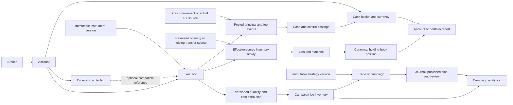

# Domain boundaries and financial development

**Source-reviewed:** 26 October 2026 for Phase 19 Checkpoint 6, against Checkpoint 5 commit `d9a96d7099a29b08bb7b055a64e17c0b7ab40e1c` and application baseline `5132900a03efabaeb307787531546987228220e7`. This guide explains how to work with the implemented model. It does not replace the authoritative [domain model](../domain-model.md), [calculation contracts](../financial-calculations.md), [financial metrics](../financial-metrics.md), [portfolio accounting dictionary](../portfolio-accounting.md) or [analytics definitions](../analytics-definitions.md).

The logical domain model also describes planned obligations. Its entity list is not proof that every lifecycle, UI or calculation is delivered. Use the [feature inventory](../feature-inventory.md), current types/services/migrations and their tests to establish implementation. The [asset-class audit](../asset-class-audit.md) is the current capability boundary. [Checkpoint 5 evidence](../operations/verification.md) is historical for this checkpoint: its seven-advisory audit failure, including two critical findings, and the open FA-04 capacity gate remain unresolved. Current developer validation belongs to [checkpoint verification](verification.md).

## Start with the authority of a fact

The implementation keeps source evidence, accounting effects, analytical attribution and human interpretation separate. A developer must identify which layer owns a value before changing its producer or consumer.

| Concept                   | Implemented responsibility and relationship                                                                                                                                                     | What it does not imply                                                                                                                                                    |
| ------------------------- | ----------------------------------------------------------------------------------------------------------------------------------------------------------------------------------------------- | ------------------------------------------------------------------------------------------------------------------------------------------------------------------------- |
| Broker                    | Workspace-owned source/counterparty identity with a source namespace; accounts can reference it.                                                                                                | A broker record does not install a CSV adapter, live connection, margin engine or pricing formula.                                                                        |
| Account                   | Custody/accounting scope with immutable settings versions: environment, base currency, inventory policy, short permission and holding mode. It owns cash buckets, orders and source executions. | Creating an account adds no funding. Base currency does not restrict the currencies of actual balances. Paper and live facts cannot be combined indiscriminately.         |
| Currency                  | Monetary-unit identity and effective convention versions, including display scale and booking increment. Currency identity travels with every amount.                                           | Matching display codes alone do not merge units; display decimals are not actual settlement precision.                                                                    |
| Instrument                | Stable economic identity plus immutable metadata versions specifying quantity/price units, quote/settlement currency, multiplier, increments, capability and conventions.                       | A family, symbol or multiplier alone cannot enable native economics. A new version must not silently reinterpret an earlier fill.                                         |
| Order/order leg           | Recorded instruction, quantity/ratio, status and amendment evidence; an execution can reference a compatible order leg.                                                                         | A working, filled or canceled status does not itself post cash or inventory. Actual fills remain authoritative even when instruction history is incomplete.               |
| Execution/fill            | Actual account/instrument-version/side/quantity/price evidence, source identity, economic ordering, cash effects and costs. Native recording dispatches the permitted booking/replay path.      | A fill is not automatically a completed campaign or a second journal transaction. Theoretical notional and actual booked principal are distinct.                          |
| Trade/campaign and leg    | A decision/review identity whose legs select an account, exact instrument version and direction. Execution-allocation versions assign source quantities to those legs.                          | Campaigns do not own additional account cash or holdings. A single fill can be split across campaigns and an unassigned remainder.                                        |
| Position                  | Rebuildable account/instrument holding-book state at a source revision, obtained from effective inventory sources.                                                                              | A broker position/account-value observation cannot overwrite canonical inventory. Campaign exposure is a different analytical view.                                       |
| Lot and match             | Acquisition/opening lineage, remaining basis/cost pieces and the slices consumed by exits under the applicable policy.                                                                          | A lot is not a campaign. Average pooling must not erase original cost or FX provenance, and an unknown opening basis is not zero.                                         |
| Cash movement and posting | An actual monetary event produces balanced per-account/event/currency postings. Cash targets affect balances; named control targets explain counterparts.                                       | A cash movement is not necessarily trading profit; control counterparts are not more cash or NAV.                                                                         |
| Actual FX conversion      | Actual positive source/destination amounts move two monetary units, with separately identified costs and reviewed rate evidence where required.                                                 | It is not a general reporting-market observation. Reporting translation never exchanges the account's actual cash.                                                        |
| Fee/cost                  | One signed original charge/rebate identity in its actual currency and time, with independent analytical allocation axes.                                                                        | The same fee shown in cash, inventory and a campaign is not three charges. Estimates and missing fees are not actual zero cost.                                           |
| Strategy/version          | Account-independent playbook with immutable definitions, setups/checklists/typed parameters and explicit historical campaign links.                                                             | Editing/publishing a strategy does not rewrite executions or retroactively reclassify a pinned version. Narrative rules are not automatically evaluated financial policy. |
| Journal/plan/review       | Campaign-linked draft/revisions and immutable plan publications, original-risk commitment, supplemental risk and private attachments. Standalone period reviews are separate records.           | Notes or reported prices do not replace ledger actuals. A late plan or later risk addition cannot supply original pre-trade R.                                            |

The source types are [catalog DTOs](../../packages/server/src/financial/catalog-types.ts), [ledger inputs/results](../../packages/server/src/financial/ledger-types.ts), [inventory types](../../packages/domain/src/inventory-types.ts), [strategy contracts](../../packages/contracts/src/strategies.ts) and [journal contracts](../../packages/contracts/src/journal.ts). The [database guide](database-migrations.md) owns schema organization and exact physical constraints.

## Trace the implemented relationships

This is a logical dependency diagram, not a complete physical foreign-key diagram. Every tenant reference still includes its workspace boundary; labels/symbols do not stand in for identities.

An [immutable portfolio version](../portfolio-accounting.md#scope-and-history) selects account membership for a report; it does not move money or create another asset. Owned transfer departure/receipt evidence can create a once-counted transit asset for the relevant scoped interval. A transfer outside the selected ownership population can instead cross its capital boundary. Inspect [transfers and transit](../portfolio-accounting.md#transfers-and-money-in-transit) rather than treating every transfer as a sale or deposit.

## Preserve identity, precision, time and history

### Identity and authorization

Tenant identity is `(workspace_id, id)` with UUIDv4 references and composite tenant foreign keys. The application obtains a current authorization context before entering `withWorkspaceContext`; [transaction helpers](../../packages/database/src/index.ts) set transaction-local actor/workspace context and forced RLS constrains database access. A correctly formatted UUID from another workspace is still inaccessible. The pure domain package has no authentication authority.

Financial service mutation requires owner/editor authorization; viewer reads do not confer write access. HTTP Origin/CSRF and command-key checks belong to the authenticated API boundary, not to a frontend convention or a type cast. Read the [API reference](api-reference.md) and [security model](../security.md) before adding a command route. Passing a handcrafted context directly to a test service is not a production authentication mechanism.

### Decimal values and units

The [decimal kernel](../../packages/domain/src/decimal.ts) accepts bounded dot-decimal **strings**, normalizes them and rejects values outside `NUMERIC(78,36)` rather than silently rounding accepted source inputs. Its isolated Decimal.js context has 160 working digits; named derived boundaries use HALF_EVEN and scale 36. Financial values must never pass through authoritative JavaScript `Number` arithmetic. Chart/display conversion is a presentation boundary, not an input to another accounting calculation.

`DecimalString` and other brands in [the domain entry point](../../packages/domain/src/index.ts) are compile-time vocabulary. Runtime values acquire trust through the parser/validator; `as DecimalString` cannot validate external input. `decimal`, `positiveDecimal`, `assertIncrement` and the public contract schemas enforce different checks and should not be substituted for one another.

Keep amount/currency, quantity/unit, price convention/multiplier and observed-rate pair direction explicit. Never add unlike units or infer them from a label. Source precision, actual booking increment, derived quantization and display scale are separate. `allocateDecimal` partitions exact scale-36 amounts with deterministic stable-ID remainders; adding a new target must retain per-source conservation, including rebates and residuals. The canonical [precision contract](../financial-calculations.md) owns the mathematics.

### Economic time and revisions

Persisted financial APIs require an ISO instant with explicit offset and at most six fractional digits, plus a nonnegative integer-string `orderingKey` where the command requires economic ordering. PostgreSQL stores microseconds; the pure kernel's finer instant helper is not a promise of nanosecond persistence. Retain original source timestamp/convention evidence. Never replace an unresolved economic order with a random UUID sort to manufacture chronology.

Economic time, recorded time, command/source revision, catalog effective version, journal/strategy revision and a report's as-of boundary answer different questions. A later-recorded correction may restate an earlier economic instant at a newer source revision. A pinned historical view must retain the older effective source/correction leaves and dependencies. Source revisions order accepted knowledge; they do not replace economic ordering.

The [financial command repository](../../packages/server/src/financial/repository.ts) locks the workspace financial-state row and atomically commits its revision, financial facts, canonical replay, stored command result, audit and durable outbox intent. The same key/payload returns its stored result; a changed payload for that key conflicts. Throwing rolls back the tentative revision. This serialization is deliberately conservative and remains subject to the open capacity gate; it is not license to bypass the lock in a new importer.

Service input types include internal `commandId` values. Public financial HTTP bodies obtain command identity from `Idempotency-Key`; do not copy an internal service input unchanged into a public request body. Separate source identity/fingerprint checks handle identical-source no-ops or review-required changed economics. Idempotent command retry and broker-source duplicate detection are different mechanisms.

## Respect conservation and projection invariants

1. **Cash balances from postings.** Each account/event/currency population has at least two postings and exact zero sum; EUR cannot cancel USD. A posting chooses one cash or named control target. Native cash balance reads include original/reversal/replacement cash postings as appropriate; controls do not enter NAV. Source: [postings kernel](../../packages/domain/src/postings.ts), [ledger service](../../packages/server/src/financial/ledger.ts) and [ledger migration](../../packages/database/migrations/0002_core_financial_ledger.sql).
2. **Book economic principal once.** A native fill posts its actual permitted principal and charges once. Settlement moves the existing signed amount between buckets, not another purchase/sale. Conversion source/destination amounts are actual cash facts; reporting FX is a separate observation/dependency. Use [financial metrics](../financial-metrics.md#cash-and-nav) for the current cash/NAV meaning.
3. **Replay effective sources before matching.** Corrected/superseded fills and openings resolve by source revision before inventory replay. An exact bookkeeping reversal does not fabricate a disposal. Rebuildable current projections may change; accepted source/audit history stays append-only. A missing operand propagates an explained unknown state rather than available zero.
4. **Keep account inventory and campaigns separate.** Effective allocation items plus the explicit residual conserve the original execution quantity. Campaign FIFO attribution does not override the account's FIFO/average/specific-lot policy. Each fee identity/currency is conserved within each attribution axis; inventory and campaign axes are alternative explanations, not costs to add together. [Campaign bridge definitions](../financial-metrics.md#campaign-attribution-and-account-bridge) own reconciliation of those views.
5. **Handle partial exits and zero crossing explicitly.** A close consumes eligible lot slices and their costs once; a crossing fill can close old exposure then open the remainder. `closeOnly` cannot consume more inventory than exists. Unknown-basis openings keep quantity evidence without invented basis/profit. Concurrency must revalidate the authoritative book inside the transaction, not consult a stale chart.
6. **Keep closure an explicit lifecycle fact.** `confirmTradeClosure` requires effective assigned activity, every campaign leg exactly flat and no actual unresolved settlement obligations. A flat account position is not sufficient. Closure retains reason/evidence/revision; source changes can require closure review and remove completed/R eligibility. No campaign reopen workflow is invented by this guide. Source: [catalog lifecycle service](../../packages/server/src/financial/catalog.ts).
7. **Version interpretation independently.** Strategy publication, journal save, original-plan commitment and financial recording have separate revision semantics. Original R needs a genuine pre-trade positive original-risk commitment and compatible complete financial outcome. A current scenario risk estimate or later publication cannot repair the historical denominator. Source: [journal service](../../packages/server/src/journal/service.ts) and [R kernel](../../packages/domain/src/journal.ts).

Do not repair an invariant by direct ledger, allocation, hash or projection-table edits. Use the guarded source correction/reversal/attribution path and retain provenance. Deferred SQL constraints and append-only guards are part of correctness, not optional performance checks. [Correction examples](../financial-fixtures.md#f-08--corrections-closure-and-no-synthetic-realized-sale) state independent expected effects.

## Use the right calculation boundary

The native gate currently permits the documented ordinary delivered shares/ETFs and non-rebasing spot crypto conventions in a netted account. Native security shorts require their exact borrowed-delivery/explicit-carry declarations and actual charge evidence. See [current gates](../asset-class-audit.md#gates-that-prevent-a-universal-stock-formula), `validateNativeInstrumentMetadata` in [reference data](../../packages/server/src/financial/reference-data.ts) and the [inventory guard](../../packages/domain/src/inventory.ts). A trusted pure-kernel input alone is not a public grant of native support.

Other cataloged instruments can retain manual quantities, signed source quotes and explicit actual cash where the contract permits them. Automatic derivative/fixed-income settlement, lifecycle, valuation and tax engines are not delivered by adding metadata. Reviewed supplied residual/campaign components have their own definitions, source revision, quantity/time/freshness and exclusion rules; they replace a compatible component and never post cash. [Supplied-value documentation](../supplied-values.md) owns that boundary.

Account accounting, campaign analytics and account performance are separate kernels/populations:

- The [accounting dictionary](../portfolio-accounting.md) owns interval equity/capital/performance/fees/income/tax/FX/transit and reconciliation meanings. A complete NAV can coexist with incomplete historical P&L attribution; an unexplained variance is not an FX plug.
- [Campaign analytics](../analytics-definitions.md) owns selected whole-campaign cohort rules, complete monetary outcomes versus eligible completed/R samples, grouping, expectancy/profit-factor and the monetary cumulative drawdown curve. A multi-leg campaign is not copied wholesale into every account group.
- [Account returns](../account-performance-and-corrections.md#account-series-and-return-definitions) owns raw NAV versus unitized flow-adjusted series, conditional TWR/ACT/365 MWR and sampled drawdown/recovery. Deposits are capital flows, not trade profit or recovery. Do not sum campaign percentages or R to create an account return.

Availability types differ by contract: inventory uses available/unavailable/unsupported states; NAV and accounting can expose partial known subtotals; analytics also distinguishes infinite and unavailable ratios. Preserve reason codes, units, sample/coverage populations and dependency manifests. Do not create a common `value ?? 0` adapter that erases these distinctions. The older phase references retain dated scope statements; current source/contracts and the feature inventory establish delivered behavior.

## Major domain and financial modules

The public package entry point is [domain/index.ts](../../packages/domain/src/index.ts); the package depends on Decimal.js, not React, HTTP, PostgreSQL or contracts. Server factories depend on authorized platform/repository access and invoke pure kernels; HTTP adapters own transport validation. This table identifies the important interfaces rather than reproducing every function signature.

| Module                                                                                                                                                                                                      | Purpose and responsibilities                                                                                                                    | Dependencies and public interfaces                                                                                                                                                                                                                                                                                                  | Relevant tests                                                                                                                                                                                                                                                                      | Extension considerations                                                                                                                                                           |
| ----------------------------------------------------------------------------------------------------------------------------------------------------------------------------------------------------------- | ----------------------------------------------------------------------------------------------------------------------------------------------- | ----------------------------------------------------------------------------------------------------------------------------------------------------------------------------------------------------------------------------------------------------------------------------------------------------------------------------------- | ----------------------------------------------------------------------------------------------------------------------------------------------------------------------------------------------------------------------------------------------------------------------------------- | ---------------------------------------------------------------------------------------------------------------------------------------------------------------------------------- |
| [Decimal and money](../../packages/domain/src/decimal.ts), [money helpers](../../packages/domain/src/money.ts)                                                                                              | Parse bounded source decimals; quantify explicit boundaries; conserve deterministic amount allocation and original-currency charges.            | Isolated Decimal.js context; `decimal`, `quantizeDecimal`, `allocateDecimal`, `positiveDecimal`, `assertIncrement`, `feeTotals`, calculation manifest.                                                                                                                                                                              | [Decimal tests](../../tests/unit/financial-decimal.test.ts), [independent fixture tests](../../tests/unit/financial-independent-fixtures.test.ts).                                                                                                                                  | Preserve storage envelope, signed rebates, stable ties and source precision. Do not globally reconfigure Decimal.js or round input to display scale.                               |
| [Postings](../../packages/domain/src/postings.ts)                                                                                                                                                           | Validate per-account/event/currency balance; derive cash; construct/reverse classified cash/settlement postings.                                | Decimal/instant helpers; `assertBalancedPostings`, `cashBalances`, `makeCashMovementPostings`, `makeSettlementPostings`, `reversePostings`.                                                                                                                                                                                         | [Independent fixtures](../../tests/unit/financial-independent-fixtures.test.ts), [ledger integration](../../tests/integration/financial-ledger.test.ts).                                                                                                                            | A new event classifier must retain exact currency balance and one cash/control target, with matching SQL/source validation.                                                        |
| [Inventory and types](../../packages/domain/src/inventory.ts)                                                                                                                                               | Resolve effective sources; replay lots/policies/transfers; partition source/cost attribution; value compatible inventory.                       | Decimal/valuation primitives; `replayInventory`, `prepareHoldingTransfer`, `allocateCampaignExecution`, `replayCampaignInventory`, `reconcileCampaignInventory`, `valueInventory`.                                                                                                                                                  | [Inventory](../../tests/unit/financial-inventory.test.ts), [transfer](../../tests/unit/financial-inventory-transfer.test.ts), [campaign](../../tests/unit/financial-inventory-campaign.test.ts), [blocked valuation](../../tests/unit/inventory-blocked-valuation.test.ts).         | New native economics need convention gates, replay/SQL/provenance support and independent operation fixtures. Manual capability is not a universal fallback formula.               |
| [Valuation](../../packages/domain/src/valuation.ts)                                                                                                                                                         | Select eligible direct/inverse FX; translate compatible amounts; calculate NAV and separate monetary/holding/conversion FX effects.             | Decimal/money/instant context; `selectFxRate`, `createFxRateSelector`, `translateAmount`, `calculateNav`, `cashFx`, `holdingFx`, `conversionDifference`.                                                                                                                                                                            | [Valuation](../../tests/unit/financial-valuation.test.ts), [observations integration](../../tests/integration/financial-observations.test.ts).                                                                                                                                      | Preserve no-future selection, explicit freshness/source priority, zero/identity behavior and pinned observation provenance. No implicit triangulation.                             |
| [Accounting](../../packages/domain/src/accounting.ts), [account performance](../../packages/domain/src/account-performance.ts)                                                                              | Build interval equity/performance bridge and conditional flow-adjusted return series.                                                           | Explicit accounting/valuation inputs; `calculateAccounting`, `calculateAccountPerformance`; typed outputs in [accounting types](../../packages/domain/src/accounting-types.ts).                                                                                                                                                     | [Accounting unit](../../tests/unit/portfolio-accounting.test.ts), [performance unit](../../tests/unit/account-performance.test.ts), [reports integration](../../tests/integration/portfolio-accounting-reports.test.ts).                                                            | Keep capital-flow boundaries, owned transit and once-counted costs distinct. Preserve unsupported/ambiguous solver and sampling states.                                            |
| [Analytics](../../packages/domain/src/analytics.ts), [journal financial helpers](../../packages/domain/src/journal.ts)                                                                                      | Summarize whole-campaign outcomes/groups/curves and calculate weighted actual fill prices/original-risk R.                                      | Typed source/context populations; `calculateAnalytics`, `journalWeightedPrice`, `originalRiskR`; versioned definitions.                                                                                                                                                                                                             | [Analytics](../../tests/unit/analytics.test.ts), [properties](../../tests/unit/analytics-properties.test.ts), [journal financial](../../tests/unit/journal-financial.test.ts), [independent analytics integration](../../tests/integration/analytics-independent-fixtures.test.ts). | Define eligible numerator/denominator populations, zero/infinite/missing behavior, chronology and grouping conservation before exposing a metric.                                  |
| [Financial repository](../../packages/server/src/financial/repository.ts), [catalog](../../packages/server/src/financial/catalog.ts)                                                                        | Serialize/retain financial commands; validate and version currencies/accounts/instruments/orders/campaign lifecycle.                            | Authorized `FinancialPlatform`, SQL and strict schemas; `executeFinancialCommand`, `createCatalogServices` with create/append/read/order/trade/closure operations.                                                                                                                                                                  | [Catalog integration](../../tests/integration/financial-catalog.test.ts), [database constraints](../../tests/integration/financial-database.test.ts), [financial API](../../tests/integration/financial-api.test.ts).                                                               | New writes must use shared command/tenant/version guards; a catalog change must not reinterpret accepted economics or add transport fields to service DTOs.                        |
| [Ledger](../../packages/server/src/financial/ledger.ts), [observations](../../packages/server/src/financial/observations.ts)                                                                                | Book actual source effects, replay canonical inventory, preserve correction/allocation history; retain/select price/FX/account observations.    | Financial command/repository/catalog helpers and pure kernels; `createFinancialLedger` (`recordExecution`, `recordCashMovement`, `recordFxConversion`, `correctExecution`, `allocateExecution`, `positions`, `campaignInventory`) and `createFinancialObservations` (`recordFxObservation`, `recordPriceObservation`, `valuation`). | [Ledger](../../tests/integration/financial-ledger.test.ts), [financial campaign](../../tests/integration/financial-correctness-campaign.test.ts), [observations](../../tests/integration/financial-observations.test.ts).                                                           | Adapters must reuse these services, not bypass them with direct postings. Keep recordable manual evidence separate from supported automatic valuation.                             |
| [Account services/reporting](../../packages/server/src/accounting/service.ts), [report](../../packages/server/src/accounting/report.ts), [performance](../../packages/server/src/accounting/performance.ts) | Version portfolio membership; record typed income/tax/expense/transfers; assemble explicit-scope report/performance inputs.                     | Authorized transactions, immutable source/metadata readers, accounting kernel; `createAccountingServices`, `createAccountingReports`, `createAccountPerformance` and the [typed reversal factory](../../packages/server/src/accounting/corrections.ts) `createAccountingCorrections`.                                               | [Accounting services](../../tests/integration/portfolio-accounting-services.test.ts), [reports](../../tests/integration/portfolio-accounting-reports.test.ts), [API](../../tests/integration/portfolio-accounting-api.test.ts).                                                     | Preserve account/environment/portfolio boundary, typed reversals, report dependencies and bounded detail. Do not substitute campaign totals for account equity.                    |
| [Analytics service](../../packages/server/src/analytics/service.ts), [cohort](../../packages/server/src/analytics/cohort.ts), [sources](../../packages/server/src/analytics/sources.ts)                     | Assemble one authorized repeatable-read source/metadata context, enforce scope budgets and validate the analytics receipt.                      | Financial platform, inventory/observations, kernel and contract schemas; `createAnalyticsServices(...).report`.                                                                                                                                                                                                                     | [Services](../../tests/integration/analytics-services.test.ts), [API](../../tests/integration/analytics-api.test.ts), [source/FX unit](../../tests/unit/analytics-sources-fx.test.ts).                                                                                              | Add explicit source-selection/budget/error tests as well as kernel arithmetic. A read-only POST is not automatically a financial mutation.                                         |
| [Strategies](../../packages/server/src/strategies/service.ts), [journal](../../packages/server/src/journal/service.ts)                                                                                      | Publish immutable playbooks and exact trade links; save journal revisions, original plans, supplemental risk and actuals beside interpretation. | Platform access, contracts, version/financial readers; `createStrategyServices`, `createJournalServices` with create/save/publish/read/history operations.                                                                                                                                                                          | [Strategies](../../tests/integration/strategy-services.test.ts), [journal](../../tests/integration/journal-services.test.ts), [journal financial](../../tests/integration/journal-financial.test.ts).                                                                               | Version changes must preserve historical pins and original risk. Adding a narrative/typed field is not permission to recompute authoritative cash or auto-evaluate arbitrary code. |

Risk/scenario, supplied-value, reconciliation, period-review and native-outbox modules have their own typed contracts and current references: [risk](../risk.md), [supplied values](../supplied-values.md), [statement reconciliation](../statement-reconciliation.md), [period reviews](../period-reviews.md) and [financial outbox](../financial-outbox.md). A native outbox snapshot is durable cash/quantity projection, not historical NAV or a bulk analytics engine. See the [architecture guide](architecture.md) for their placement and the [repository map](repository-structure.md) for entry points.

## Test financial changes with independent evidence

Begin with [financial fixtures](../financial-fixtures.md), whose requirement IDs and expected values are obligations rather than a claim every scenario is implemented. Add the actual supported example to [independent kernel fixtures](../../tests/unit/financial-independent-fixtures.test.ts) or the appropriate narrower suite. Expected values must be derived independently from source amounts/units/ordering; calling the production helper to manufacture its own expected result only checks itself.

| Change or risk                   | Required evidence for review                                                                                                                                                                                                                                 |
| -------------------------------- | ------------------------------------------------------------------------------------------------------------------------------------------------------------------------------------------------------------------------------------------------------------ |
| Decimal/rounding/allocation      | Storage edges, long significant products, signed values/rebates, deterministic tied remainders, zero weights/invalid inputs and exact per-source conservation. Check the final storage boundary, not only working precision.                                 |
| Fill/lot policy                  | Fractional partial entries/exits, FIFO/average/specific selection, shorts and both zero-crossing directions, close-only rejection/atomic rollback, unknown openings, actual versus theoretical principal and retained cost/rate lineage.                     |
| Fees and attribution             | Entry/exit/carry costs, original currencies, zero foreign fee without FX versus nonzero missing FX, shared fills, unassigned residuals, changed allocation versions and no duplicate cash.                                                                   |
| FX/observations                  | Explicit pair direction, direct/inverse selection, source priority/freshness, same-currency and evidenced zero, no future observation (including adjacent microseconds), signed manual quotes and compatible metadata versions.                              |
| Corrections/history              | Original/reversal/replacement effects, effective source leaves, replay at earlier pinned revisions, source identity conflict and exact idempotent retry versus changed-key payload conflict.                                                                 |
| Accounts/portfolios              | Paper/live separation, multiple accounts/brokers, internal versus scope-boundary transfers, delayed owned transit and receipt/reversal, raw cash/holdings/NAV versus period performance, explicit known subtotal/variance.                                   |
| Campaign/metrics                 | Account-lot versus campaign-attribution bridge; partial/open/closed eligibility; multi-leg/group conservation; complete money versus missing original R; empty/all-win/all-loss/breakeven samples, infinite/undefined ratios and unavailable chronology.     |
| Return series                    | Capital-flow boundaries, positive capital, missing intermediate valuations, ambiguous same-instant ordering, MWR root/overflow limits and sampled recovery; no summed campaign percentages.                                                                  |
| Persistence/security/concurrency | Real PostgreSQL restricted roles, forced/composite tenant scope, deferred conservation guards, rollback of dependent writes, concurrent close/correction/retry behavior and coherent read snapshots. A passing pure kernel fixture does not establish these. |
| UI/contract                      | Decimal strings and units survive request/response; errors/reasons/sample coverage remain visible; actual controls reuse accepted services and cannot turn an unsupported asset or missing result into zero.                                                 |

Use the suite commands, disposable database setup and evidence rules in [testing](testing.md), [database/migrations](database-migrations.md) and [contribution workflow](contributing.md). This writer executed no financial tests; a linked test's existence is **Source-reviewed**, while fresh/historical execution must be recorded separately in [verification](verification.md). Production capacity, all advanced-asset lifecycle/tax handling, live broker/feed integrations, optional MAE/MFE/slippage/risk-adjusted modules and automatic AI review remain outside this model's delivered scope.
