# Extend importers and application capabilities

Reviewed **26 October 2026** for Phase 19 Checkpoint 6 against committed Checkpoint 5 `d9a96d7099a29b08bb7b055a64e17c0b7ab40e1c`, with application baseline `5132900a03efabaeb307787531546987228220e7`. These instructions are **Source-reviewed** extension workflows; no new adapter, asset engine, metric or endpoint is implemented by this guide. [Checkpoint verification](verification.md) records any freshly executed checks. The current seven-advisory audit failure and open FA-04 capacity gate remain explicit [release risks](../operations/verification.md).

Use [architecture](architecture.md), [domain and financial model](domain-and-financial-model.md), [database migrations](database-migrations.md), [testing](testing.md) and [contribution workflow](contributing.md) alongside this guide. Existing [import architecture](../imports.md), [instrument capability contract](../instrument-capabilities.md), [asset-class audit](../asset-class-audit.md) and [analytics definitions](../analytics-definitions.md) remain subject authorities. Earlier design interfaces do not establish a delivered plug-in system.

## Know which extension boundary exists

| Change                                  | Delivered boundary                                                                                                        | Boundary that must not be inferred                                                                                                                |
| --------------------------------------- | ------------------------------------------------------------------------------------------------------------------------- | ------------------------------------------------------------------------------------------------------------------------------------------------- |
| Another broker's compatible CSV layout  | Configure the existing Universal mapping, or add trusted server parser code and register an immutable adapter ID/version. | Creating a broker record does not install a parser. There is no live broker connection, uploaded executable adapter or runtime plug-in installer. |
| Additional descriptive instrument terms | Versioned instrument metadata JSON, validated through catalog contracts/service/SQL and the relevant UI/API.              | A family/subtype label, multiplier or metadata field does not enable automatic economics.                                                         |
| Another native asset convention         | Reviewed changes to explicit native gates, dispatcher/kernels, persisted constraints, source/report readers and tests.    | There is no public instrument-handler registry accepting an arbitrary formula.                                                                    |
| Another analytic statistic or dimension | Typed contracts, pure domain calculation, coherent evidence selection and explicit display/export integration.            | There is no user formula evaluator or arbitrary metric-registration API.                                                                          |
| Strategy-specific declared input        | Existing typed strategy parameters and immutable definition versions.                                                     | Narrative risk rules are not evaluated risk policies; entity-wide custom fields are not delivered.                                                |
| Another page or API operation           | Source-controlled Next route, authorized service composition, contracts, generated API/client, tests and documentation.   | Adding a navigation item or an OpenAPI path alone does not create a protected working feature.                                                    |

These are development changes to review and ship as a new release. They do not authorize altering existing financial facts, migration history or installed production code in place.

## Import modules and their contracts

| Module                                                                                                                                                                                                                  | Purpose                                         | Responsibilities                                                                                                                         | Dependencies                                                                   | Public interfaces                                                                                                                                                                      | Relevant tests                                                                                                                                               | Extension considerations                                                                                                                                       |
| ----------------------------------------------------------------------------------------------------------------------------------------------------------------------------------------------------------------------- | ----------------------------------------------- | ---------------------------------------------------------------------------------------------------------------------------------------- | ------------------------------------------------------------------------------ | -------------------------------------------------------------------------------------------------------------------------------------------------------------------------------------- | ------------------------------------------------------------------------------------------------------------------------------------------------------------ | -------------------------------------------------------------------------------------------------------------------------------------------------------------- |
| [Import contracts](../../packages/contracts/src/imports.ts)                                                                                                                                                             | Define the neutral import vocabulary.           | Bound file/row/group input, mappings, canonical drafts/payloads, previews and results.                                                   | Zod and financial/accounting DTO schemas.                                      | `ImportKind`, `ImportMapping`, `CanonicalImportDraft`, `IMPORT_LIMITS`, `canonicalImportPayloadSchemas` and named request/response schemas.                                            | [Parser/contract cases](../../tests/unit/imports.test.ts), [safety cases](../../tests/unit/imports-safety.test.ts).                                          | A new canonical event kind requires downstream ledger/service, persistence, API and correction/reconciliation review, not merely another parser switch.        |
| [Adapter registry](../../packages/server/src/imports/adapters/registry.ts)                                                                                                                                              | Turn trusted broker text into neutral rows.     | Select exact adapter identity/version; retain raw cells and row errors; expose installed adapter metadata.                               | Contracts, CSV normalization and decimal helpers.                              | `ImportAdapter`, `ParsedImportRow`, `ImportAdapterRegistry.register/get/list`, `genericCsvAdapter`, `canonicalCsvAdapter`.                                                             | [Import unit tests](../../tests/unit/imports.test.ts), [unavailable adapter safety](../../tests/unit/imports-safety.test.ts).                                | Default registry contains only `generic-csv@1` and `canonical-csv@1`. Duplicate identity/version is rejected. Parser code is trusted server code.              |
| [CSV and normalization](../../packages/server/src/imports/csv.ts), [draft normalization](../../packages/server/src/imports/normalize.ts)                                                                                | Preserve source meaning and canonical identity. | Parse bounded CSV/JSON; normalize exact decimal/time text; bind account scope; resolve safe local dependencies and fingerprints.         | Contracts, domain decimals and financial source helpers.                       | `parseCsv`, `normalizeDecimal`, `normalizeInstant`, `parseImportJson`, `validateDraft`, `importIdentity`, `rowReferences`, `resolveReferences`.                                        | [CSV/time/identity tests](../../tests/unit/imports.test.ts), [safety tests](../../tests/unit/imports-safety.test.ts).                                        | Preserve stable IDs, units, offsets/microseconds and missing facts. Reject reserved keys/cycles instead of evaluating arbitrary expressions or property paths. |
| [Import services](../../packages/server/src/imports/service.ts), [templates](../../packages/server/src/imports/templates.ts)                                                                                            | Persist review and orchestrate guarded posting. | Source retention, dependency groups, preview simulation, stale checks, duplicates/corrections, immutable history and versioned mappings. | Authorized workspace transactions, registry, import ledger port and contracts. | `createImportServices(platform, registry)` returns `stage/preview/commit/reverse/detail/history/source/registry`; `createImportTemplates` returns `save/list/catalog`.                 | [PostgreSQL imports](../../tests/integration/imports.test.ts), [PostgreSQL safety](../../tests/integration/imports-safety.test.ts).                          | Do not skip preview or create another financial write when a source claim is a duplicate/correction. Template versions pin adapter identity/version.           |
| [Ledger port](../../packages/server/src/imports/ledger-port.ts)                                                                                                                                                         | Reuse ordinary financial command invariants.    | Apply canonical commands inside the existing transaction; reconcile execution cash; dispatch supported corrections/reversals.            | Catalog, ledger, observations, accounting, cash reversal and savepoints.       | `importLedgerPort(tx)` returns `apply/reconcileCash/correct/reverseCash`.                                                                                                              | [Atomic imports/corrections](../../tests/integration/imports.test.ts), [financial campaign](../../tests/integration/financial-correctness-campaign.test.ts). | An adapter must not issue its own SQL postings or duplicate native principal/fees. Generic correction is not available for every kind.                         |
| [Import HTTP boundary](../../packages/server/src/imports/api.ts), [browser workspace](../../apps/web/src/components/imports/import-workspace.tsx), [file decoder](../../apps/web/src/components/imports/import-file.ts) | Present a private reviewed workflow.            | Authorization/mutation proof, bounded bodies, exact file decoding, installed catalog, mapping and review controls.                       | Server services, schemas, registry, same-origin API and UI state.              | `createImportApi(platform, registry)`; `readImportFile(file)`; Next [import catch-all composition](../../apps/web/src/app/api/v1/workspaces/[workspaceId]/imports/[...path]/route.ts). | [Import UI](../../tests/ui/imports.test.tsx), [file decoding](../../tests/unit/import-file.test.ts), [browser journey](../../tests/e2e/imports.spec.ts).     | Keep UTF-8 evidence/BOM behavior, safe text-only downloads, role/tenant isolation and uncertain-response behavior. Do not add a hidden bypass button.          |

The adapter's current synchronous TypeScript contract is the small source-defined boundary below, not a complete parser implementation:

```typescript
type ImportAdapter = {
  id: string;
  version: string;
  name: string;
  parse(content: string, mapping: ImportMapping): ParsedImportRow[];
};
```

`ImportMapping` and `ParsedImportRow` are the actual types in the linked contracts/registry. Each parsed row carries its physical row number, original cell map, optional neutral draft and structured errors. Do not call ledger or network services from `parse`.

```mermaid
flowchart LR
  File["Private UTF-8 source"] --> Adapter["Registered adapter + mapping version"]
  Adapter --> Draft["Neutral draft + raw cells + errors"]
  Draft --> Stage["Stage source and review rows"]
  Stage --> Preview["Validate complete dependency groups"]
  Preview --> Sim["Financial commands in rollback simulation"]
  Sim --> Saved["Retained preview and source revision"]
  Saved --> Commit["Explicit guarded commit"]
  Commit --> Port["Existing ledger/catalog/accounting commands"]
  Port --> Facts["Atomic accepted groups + provenance"]
```



Staging and preview write private review metadata; they do not persist the simulated financial changes. The preview deliberately rolls back its nested simulation, then stores its reviewed result. Commit requires the matching preview/financial context and complete selected groups. A diagram arrow does not erase row errors or authorize posting.

## Add support for a broker CSV layout

1. Obtain the producer's documented layout and build a minimal fictional fixture. Establish decimal/grouping rules, encoding, delimiter, timestamp/offset convention, monetary units, side/sign meanings, actual fees/cash and reliable source identifiers. Never commit a customer statement or infer semantics from a ticker/header alone.
2. Prefer the existing Universal mapping when its explicit transformations suffice. Its field/value maps, constants, kind-specific targets and `$row` references already handle compatible layouts without new executable parser code. Use [canonical synthetic examples](../examples/imports/README.md) to understand the accepted shapes; those are interchange examples, not named-broker compatibility claims.
3. If actual parser logic is necessary, implement a trusted `ImportAdapter` in the server import area. Reuse bounded CSV/JSON and exact decimal/instant helpers. Return raw evidence, a canonical draft or errors; do not silently discard an unsupported row or invent zero costs, currencies, fills or initial balances.
4. Assign a stable adapter ID and version. Construct a default `ImportAdapterRegistry`, call `register` with the new adapter, and pass that registry as the second argument of `createImportApi` at the existing Next composition point. This is a source-controlled dependency-injection path; the default constructor already retains both shipped adapters. Exposing a broker name in the catalog is not registration.
5. Keep old versions available when saved mappings must remain usable. Do not change historical parser behavior behind an unchanged version. Review compatibility for retained templates/source evidence, archive restore and the normalized canonical payloads. `registry.get` rejects an unavailable ID/version; there is no remote adapter download fallback.
6. Emit only the current [fourteen canonical kinds](../../packages/contracts/src/imports.ts). The framework binds account-scoped kinds to the batch account, assigns command/source identity and validates resolved DTOs. A new economic event kind is a cross-layer feature change requiring its own contract, handler, SQL/restore and test design.
7. Keep economic dependencies complete. Source/group keys must support deterministic ordering, safe reference resolution and complete atomic groups. Current limits include 2 MiB source, 1,000 rows, 64 columns, 16 KiB fields and at most 100 rows in a selected commit. Do not split one dependent economic operation to evade the limit.
8. Test parsing first, then the full restricted-PostgreSQL workflow and UI selection. Confirm that the installed catalog lists the new version and that its mapping can stage, preview and commit only intended groups. Document the verified layout/version and unsupported source variants in the normal manual and API reference.

Stable producer IDs are preferable to a fallback fingerprint. Identity is scoped by the framework, including account/namespace; changing those or fabricating a new source ID can turn an economically duplicate event into distinct activity. Normalization canonicalizes representable decimals, source instants and dependency meaning before identity hashing. Test duplicate-only reimport, changed stable IDs, ambiguous fingerprint cases, ordering-independent references, stale preview and a lost response separately.

The ledger port currently supports explicit execution and cash-movement correction paths; other kinds can require `CORRECTION_REVIEW_REQUIRED`. Preserve those boundaries. `execution_cash` rows reconcile supplied source cash against already-booked execution economics; they are not permission to post the same principal or fee twice. Missing `costsComplete` on execution/opening-lot drafts becomes false rather than a fabricated complete-cost claim.

Required evidence for a parser change includes malformed/oversized/invalid UTF-8/BOM/quoted-multiline cases; exact decimals/grouping and DST ambiguities; unknown references/reserved keys/dependency cycles; missing account/currency/instrument conventions; source retention/hash; warning acknowledgement; duplicate/correction behavior; group rollback; actual cash reconciliation; and role/CSRF/tenant denial. Use [testing](testing.md) for commands and disposable setup. The existing [import architecture](../imports.md) and [user manual](../user-guide/imports-and-exports.md) own the detailed workflow semantics.

## Add instrument metadata without granting unsupported economics

Instrument identity and each immutable convention version are distinct. See [domain relationships](domain-and-financial-model.md) and [capability definitions](../instrument-capabilities.md) before adding another descriptive term.

1. Decide whether the change is descriptive metadata, a new convention version or a different economic identity. The catalog's bounded metadata JSON can carry subtype-specific terms; it does not require unrelated common columns for every family. Keep missing knowledge explicit. A new persisted constraint or shape can still require a forward migration.
2. Update the appropriate [financial contracts](../../packages/contracts/src/financial.ts), [catalog validation](../../packages/server/src/financial/catalog.ts), browser setup/advanced fields and relevant SQL guards together. The service limits serialized instrument metadata to 32 KiB. Runtime JSON acceptance does not independently validate a new bond/option/futures convention.
3. Preserve exact `instrumentVersionId`, effective/recorded boundaries and history. `appendInstrumentVersion` checks optimistic revision and strictly later effective instants. Existing history cannot be reinterpreted by editing the newest version.
4. Preserve the `UNIT_TRANSFORMATION_REQUIRED` and `CAPABILITY_TRANSFORMATION_REQUIRED` boundaries. Quantity-unit, known multiplier/currency changes or automatic/manual capability changes over used history need a separately designed transformation/new identity; no generic transformation editor is delivered.
5. Add contract/service/SQL/UI tests for valid, incomplete and contradictory metadata, archive/new-selection rules, historical version retrieval and late catalog pages. Link the new terms and their actual supported operations in the capability audit and manual.

The existing catalog/recording modules are [catalog service/types](../../packages/server/src/financial/catalog.ts), [reference-data validation](../../packages/server/src/financial/reference-data.ts), [advanced recorder model](../../apps/web/src/components/record/advanced-record-model.ts), [catalog setup](../../apps/web/src/components/record/catalog-setup.tsx) and [source-convention migration](../../packages/database/migrations/0015_financial_source_conventions.sql). Their dependencies are contracts, domain values and authorized database transactions; their public boundary is catalog create/version/read operations and validated recorder commands. Tests include [catalog units](../../tests/unit/financial-catalog.test.ts), [catalog integration](../../tests/integration/financial-catalog.test.ts), [catalog pagination](../../tests/integration/catalog-pagination.test.ts) and [catalog UI](../../tests/ui/catalog-page.test.tsx). Extend all applicable layers rather than bypassing one validator.

## Promote another asset convention to native support

This is a financial-engineering change, not a metadata toggle. Current native gates support ordinary delivered shares/ETFs and non-rebasing spot crypto only under exact validated unit-price, multiplier-one, same quote/settlement currency conventions. Native shorts require their additional explicit borrowed-delivery/carry-cost evidence. `validateNativeInstrumentMetadata`, `assertNativeInstrumentMetadata` and `supportsNativeShortInventory` in [reference data](../../packages/server/src/financial/reference-data.ts) are actual code gates, not a general plug-in registry.

The pure [inventory kernel](../../packages/domain/src/inventory.ts), [valuation](../../packages/domain/src/valuation.ts), [postings](../../packages/domain/src/postings.ts), [accounting](../../packages/domain/src/accounting.ts) and [risk sizing](../../packages/domain/src/risk.ts) provide deterministic economic operations over typed validated inputs. They depend on domain decimal/unit/time policies rather than Next, PostgreSQL or a broker parser. Their public functions include `replayInventory`, `valueInventory`, `selectFxRate`, `calculateNav` and `calculateAccounting`; [domain exports](../../packages/domain/src/index.ts) are the package boundary. The server supplies authorized source/revision evidence and persists guarded commands; a kernel must not perform I/O or read current browser state.

For a native expansion:

1. Define contract units, signed-price behavior, principal/settlement timing, cost allocation, inventory matching, exposure, risk and valuation independently for the proposed subtype. Do not reuse quantity-times-price merely because the record has a multiplier.
2. Design the supported lifecycle and explicit unavailable cases. Account for partial fills/exits, transfers, financing, missing basis, unknown costs, stale/missing FX/marks and historical correction/replay. Record economic inputs separately from selected supplied analysis components.
3. Update the server capability/price-convention gates, domain dispatch and versioned calculation manifest, source readers, accounting/analytics/risk consumers, SQL constraints and API/UI descriptions. Review [price conventions](../../packages/server/src/financial/price-conventions.ts) and the [asset-class audit](../asset-class-audit.md); broad positive-price validation can break legitimate reviewed manual signed-price cases, while accepting signed prices does not implement automatic futures economics.
4. Preserve stable source history, exact version links and precision. Add a reviewed forward migration where SQL changes, compatible archive/calculation-version handling and explicit historical replay behavior. A family label from an importer cannot authorize native calculation.
5. Verify with independent expected arithmetic and persisted command/report cases, including fractional quantities, partial cost partitions, cross-currency fees, microsecond boundaries, zero and unavailable results, negative/manual prices where supported and rejected unsupported conventions. Confirm tenant/source/cash/quantity conservation as well as displayed metrics.

Relevant evidence lives in [asset-class unit cases](../../tests/unit/asset-class-extensibility.test.ts), [asset-class PostgreSQL cases](../../tests/integration/asset-class-extensibility.test.ts), [inventory tests](../../tests/unit/financial-inventory.test.ts), [campaign partitions](../../tests/unit/financial-inventory-campaign.test.ts), [transfers](../../tests/unit/financial-inventory-transfer.test.ts), [blocked valuation](../../tests/unit/inventory-blocked-valuation.test.ts) and [independent financial campaign](../../tests/integration/financial-correctness-campaign.test.ts). Manual recording and reviewed supplied residual/net components are distinct existing paths, not native engines to relabel as implemented.

## Add an analytics metric or dimension

| Module                                                                                                                                                                                                            | Purpose and responsibilities                                                                            | Dependencies                                                                              | Public interfaces                                                                                                     | Relevant tests                                                                                                                                                                                                          | Extension considerations                                                                                                             |
| ----------------------------------------------------------------------------------------------------------------------------------------------------------------------------------------------------------------- | ------------------------------------------------------------------------------------------------------- | ----------------------------------------------------------------------------------------- | --------------------------------------------------------------------------------------------------------------------- | ----------------------------------------------------------------------------------------------------------------------------------------------------------------------------------------------------------------------- | ------------------------------------------------------------------------------------------------------------------------------------ |
| [Analytics source selection](../../packages/server/src/analytics/sources.ts), [cohort selection](../../packages/server/src/analytics/cohort.ts), [report service](../../packages/server/src/analytics/service.ts) | Select coherent authorized campaign evidence, metadata/time/FX context, populations and bounded groups. | Database workspace transaction, financial/catalog/journal/strategy sources and contracts. | `readAnalyticsSources`, cohort helpers and `createAnalyticsServices(platform).report`.                                | [Service tests](../../tests/integration/analytics-services.test.ts), [independent fixtures](../../tests/integration/analytics-independent-fixtures.test.ts), [cohort tests](../../tests/unit/analytics-cohort.test.ts). | Preserve read-only repeatable snapshots, scope limits and distinct accounting versus campaign questions.                             |
| [Domain analytics/types](../../packages/domain/src/analytics.ts), [contracts](../../packages/contracts/src/analytics.ts)                                                                                          | Calculate typed population-aware statistics and validate their units/availability/definition identity.  | Decimal arithmetic and canonical campaign inputs; no database/UI.                         | `calculateAnalytics`, `AnalyticsMetricName`, `AnalyticsDimension`, `AnalyticsMetric`, `ANALYTICS_DEFINITION_VERSION`. | [Kernel tests](../../tests/unit/analytics.test.ts), [properties](../../tests/unit/analytics-properties.test.ts), [contracts](../../tests/unit/analytics-contracts.test.ts).                                             | No dynamic metric registry; hardcoded metric keys/units/definition IDs must evolve deliberately together.                            |
| [Dashboard service](../../packages/server/src/dashboard/service.ts), [domain views](../../packages/domain/src/dashboard.ts), [workspace UI](../../apps/web/src/components/dashboard/dashboard-workspace.tsx)      | Apply filters, derive charts/tables and expose contributing records/explanations.                       | Typed analytics report, dashboard schemas and explicit workspace/account scope.           | `createDashboardServices`, domain view functions and `DashboardWorkspace`.                                            | [Dashboard units](../../tests/unit/dashboard.test.ts), [integration](../../tests/integration/dashboard.test.ts), [UI](../../tests/ui/dashboard.test.tsx), [browser](../../tests/e2e/dashboard.spec.ts).                 | Updating a kernel alone does not display/export a new result; preserve exact tables, availability reasons and accessible drill-down. |

1. Write the mathematical definition, unit, eligibility/denominator, chronology and unavailable/partial/infinite behavior first in the canonical [analytics definitions](../analytics-definitions.md). Distinguish campaign outcomes, original-risk R, account equity/return and raw/adjusted drawdown.
2. Add the exact domain type/calculation and contract metric/unit/definition checks. Current metric definition IDs use `campaign-analytics/<key>/1`; a changed meaning needs an intentional version/compatibility decision rather than an unchanged ID around a new formula.
3. Add source evidence only when the implementation can establish it coherently. Do not convert a source-provided quantity into a calculated metric or fill a missing result with zero. An extra grouping dimension must preserve unknown/mixed/tag semantics and existing bounded cardinality.
4. Update generated schemas/client types, relevant Dashboard selection/display/format/explanation/drill-down, saved-view/field constraints and [typed exports](../../packages/server/src/portability/exports.ts) when they expose the result. Do not invent a new API filter merely because a component can render it.
5. Add independent kernel/oracle, property, contract, persisted source/revision/FX/population, API/role and UI/exact-export cases. Include empty/all-winner/all-loser/breakeven, partial/incomplete and multi-leg scope as applicable; one profitable fixture does not validate a statistic's complete semantics.

## Add strategy fields without rewriting prior playbooks

The [strategy contracts](../../packages/contracts/src/strategies.ts), [strategy service](../../packages/server/src/strategies/service.ts), [editor](../../apps/web/src/components/strategies/strategy-editor.tsx) and [journal contract](../../packages/contracts/src/journal.ts) own definition shape, immutable publication, editing and historical references. `createStrategyServices` exposes create/update/archive/read/version/linked-trade operations; it depends on authorized transactions, definition/reference validation and immutable snapshot hashing. Public HTTP composition is in the [strategy API](../../packages/server/src/strategies/api.ts).

For a playbook-specific declared value, use the delivered decimal/boolean/text/enum `parameters` and their stable IDs, units, ranges/options. They are part of an immutable strategy definition; they do not install a general custom-field engine or execute a trading/risk algorithm. Narrative `riskRules` and evaluated [risk policies](../risk.md) remain separate concepts.

For a new application-wide persisted strategy field, update its strict definition schema, defaults/limits/uniqueness and reference checks, UI editing/display, immutable hash/publication, journal pin/assessment consumers, API/schema generation, exports/portable restore and SQL JSON guards where affected. Append a new definition version rather than mutating a published one. Preserve the exact strategy version assigned to a campaign and original plan; changing the latest definition must not rewrite historical analytics. Any older archive/payload compatibility is a deliberate tested decision, not an assumed consequence of adding a default.

Use [strategy contract tests](../../tests/unit/strategy-contracts.test.ts), [strategy service tests](../../tests/integration/strategy-services.test.ts), [strategy database tests](../../tests/integration/strategy-database.test.ts), [strategy API tests](../../tests/integration/strategy-api.test.ts), [strategy UI](../../tests/ui/strategies.test.tsx) and [browser history/pin journey](../../tests/e2e/strategies.spec.ts). Include retained historical definitions and reference/tenant/attachment checks rather than testing only the new editor field.

## Add a page or API operation

1. Choose the domain/service owner and authorization boundary first. Follow the actual [repository structure](repository-structure.md), not a new parallel data-access stack. Pure financial rules stay in domain; HTTP/UI and persistence supply validated context.
2. Add strict request/response schemas in the correct `packages/contracts/src` subject module. Reuse exact decimal strings, UUIDv4/revision/instant and bounded JSON types; source schemas do not replace reference membership, chronology, conservation or SQL invariants.
3. Implement the service operation through the existing workspace transaction/command pattern. Preserve viewer/editor/owner checks, immutable revisions, source identity and command idempotency where applicable. Do not expose internal privileged SQL helpers as arbitrary endpoint parameters.
4. Compose a thin Next route or the correct feature dispatcher. Preserve [mutation security](../../packages/server/src/security.ts), bounded request parsing, required idempotency headers for the operation, private/no-store responses and response validation. Register the actual HTTP method; catch-all path syntax alone is not a delivered endpoint. Use [problem serialization](../../packages/server/src/errors.ts) and [API failure correlation](../../apps/web/src/lib/api-response.ts) with fixed operation names; do not log bodies, SQL values or raw private errors.
5. Register implemented paths and schemas in [the contract generator](../../packages/contracts/src/generate.ts), then regenerate/check the existing OpenAPI/client outputs through the commands in [testing](testing.md). `api:generate` writes the derived OpenAPI/client files; `api:check` checks drift. Never hand-edit those generated files or document an endpoint that only exists in design. Runtime refinements/business guards may exceed what OpenAPI can express, so cover them with actual schema/service tests and explanations in [API reference](api-reference.md).
6. For a page, follow the existing [Dashboard server page](../../apps/web/src/app/dashboard/page.tsx), [workspace loader](../../apps/web/src/lib/workspace-page.ts), [application shell](../../apps/web/src/components/application-shell.tsx) and feature client-component patterns. Add the typed destination/navigation entry if it is a genuine new destination. Keep server-only database/auth imports out of browser components and use the typed [same-origin client](../../packages/contracts/src/client.ts) or established feature API wrapper.
7. Add feature forms/state, loading/empty/error/unavailable/conflict/retry behavior and labels using the actual supported operation. If the feature needs private saved views/columns, extend the explicit [display-view contract](../../packages/contracts/src/display-views.ts) and mandatory identity/field constraints; there is no automatic page-registration mechanism.
8. Add contract, service/PostgreSQL authorization/conservation/idempotency, route and UI/browser tests appropriate to its risk. Include invalid body/method, missing session, wrong workspace/role, Origin/CSRF, unsupported economics and interrupted-write outcomes. Update developer/user/troubleshooting/reference documentation alongside the delivered behavior.

Read [architecture](architecture.md) for the full module boundary map and [contributing](contributing.md) for review expectations. Commands and extension changes in this chapter are source-described development work, not a claim that arbitrary new code has passed compilation, migration, security, financial or production validation.
