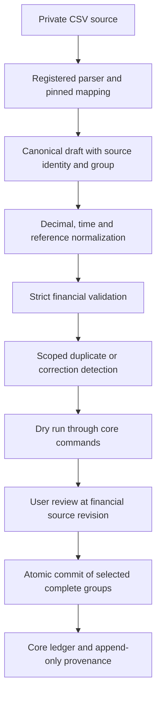

# Broker-agnostic imports

Phase 10 implements bounded CSV imports through a shared canonical model and the existing financial commands. Open **Imports** in the workspace navigation to map a file, stage its source rows, review a dry run, commit complete groups and inspect import history. CSV works without a broker API, external credentials or a named broker adapter.

The delivered adapters are **Universal CSV mapping** (`generic-csv@1`) and **Canonical CSV interchange** (`canonical-csv@1`). The interchange adapter is an application format, not evidence of compatibility with a real broker. Full statement reconciliation, lossless backup/restore, exports, native position-snapshot reconciliation and large background imports remain later work. Imported executions do not invent campaigns, plans, strategy versions or trade allocations.

## Boundaries and pipeline



`packages/server/src/imports/adapters` owns file interpretation. `packages/contracts/src/imports.ts` defines the broker-neutral envelope and mapping contracts. `normalize.ts` canonicalizes values and references; `service.ts` orchestrates review, identity, history and transactions; `ledger-port.ts` translates canonical kinds into existing catalog, ledger, observation and accounting commands. The pure financial domain contains no CSV headers, broker parsers or broker-specific accounting formulas.

An adapter returns `ParsedImportRow[]`. Each item retains the physical starting CSV line number, raw string fields, row-level issues and a draft:

```ts
type CanonicalImportDraft = {
  sourceKey: string; // Local dependency reference, unique within a batch.
  sourceId?: string; // Stable broker/event occurrence ID when available.
  groupKey: string; // Complete dependency group selected for review.
  kind: ImportKind;
  payload: Record<string, JSONValue>;
  warnings: string[];
};
```

The payload is subsequently validated against the existing strict financial DTO for its kind. Parsers cannot bypass authorization, create command identities, change accounting formulas, execute uploaded code or write directly to ledger tables.

## CSV and mappings

CSV accepts UTF-8 text, an optional BOM, LF/CRLF records, quoted delimiters, escaped double quotes and quoted multiline fields. Headers must be unique, nonempty safe names. Malformed quoting, inconsistent column counts, binary/control data and oversized input fail explicitly; rows are never silently truncated. Source row numbers are physical starting lines, so multiline cells can leave gaps in those numbers.

Universal mappings use `version: "canonical-import/1"`, a record `kind`, conventions and `fields`. Each field has exactly one `column` or `constant`, a canonical dotted `target`, an optional value-alias map and an empty-value policy (`omit`, `null` or `error`). Numeric path components support bounded arrays such as `fees.0.amount`. Overlapping scalar/object targets and prototype-sensitive paths are rejected.

| Mapping option              | Meaning                                                                           |
| --------------------------- | --------------------------------------------------------------------------------- |
| `kindColumn` / `kindValues` | Map a mixed CSV's broker row labels to explicit canonical kinds.                  |
| `sourceIdColumn`            | Stable broker/event ID; blank selected IDs are errors.                            |
| `sourceKeyColumn`           | Local key used by another row's dependency reference.                             |
| `groupColumn`               | Complete dependency group; otherwise the row's source key is its group.           |
| Field `kinds`               | Apply a field only to those kinds in a mixed file.                                |
| Field `values`              | Explicit enum, currency/instrument identity or other string aliases.              |
| Field `transform`           | `text`, `decimal`, `negate_decimal`, `instant`, `boolean`, `json` or `reference`. |

`boolean` accepts only mapped `true`/`false` strings. `json` parses data, never executable instructions. `reference` converts `sourceKey:result.path` into a local reference. In canonical JSON the equivalent is `{ "$row": "fill-1", "path": "id" }`. Every local `sourceKey` must identify exactly one row; duplicate keys are blocking errors, even when economics look identical. Any row containing a local reference also requires a stable broker source ID. Referenced results must resolve to string identities. Select an uncommitted dependency's complete group together with its dependents, or use an already committed result. Cycles and unresolved references prevent commit.

Unmapped nonempty columns remain in the raw source and generate warnings. Review and explicitly acknowledge warnings before commit; retention does not mean the importer understood the unsupported field. Symbols and currency codes are not guessed into catalog IDs. Select existing tenant-owned identities, use explicit aliases/constants, or include a valid instrument creation row and reference its result.

Saved templates have a stable identity and immutable numbered mapping versions. Updating or archiving a template appends a version using `expectedVersion`; it does not edit the mapping pinned by an earlier batch. Archived templates cannot start new imports. Batches also retain the resolved full mapping, adapter ID/version and optional template-version ID.

### Decimal and date conventions

Choose a delimiter (comma, semicolon, tab or pipe), decimal separator (dot/comma), grouping separator (`none`, dot, comma or space), date format (`iso`, `ymd`, `dmy`, `mdy`) and IANA timezone. Decimal and grouping separators must differ. Grouped integers require valid three-digit groups; exponents, expressions and ambiguous separators are rejected.

Amounts, prices, quantities and rates are canonical **decimal strings**, not JSON numbers. Normalization preserves exact value, removes redundant lexical zeros and never rounds an oversized value into acceptance. Financial contracts require at most 42 integer digits and 36 significant fractional places fitting `NUMERIC(78,36)`. Sign and positivity rules come from the relevant ledger DTO. For example, an external withdrawal is a negative cash movement; a sell fill has positive quantity and explicit `side: "sell"`. Use `negate_decimal` only when the documented source format requires that sign transformation.

ISO input requires seconds and an explicit UTC offset, with at most six fractional digits. Local `ymd`/`dmy`/`mdy` input uses the selected timezone and can contain a time; omitted time means local midnight. Impossible calendar dates, daylight-saving gaps and repeated local times are rejected. Resolve a repeated time with an ISO timestamp containing the correct offset. Normalized timestamps retain microseconds in UTC. `orderingKey` is an explicit nonnegative integer string for financial ordering; it is not inferred from filename or CSV position.

See [ready-to-adapt examples](examples/imports/README.md). The UI's **Advanced mapping and value aliases** accepts complete mapping JSON for mixed kinds, conditional fields and dependencies.

### Canonical interchange

`canonical-csv@1` uses headers `ID,Key,Kind,Group,Payload`. `Payload` is a CSV-quoted JSON object containing the canonical financial DTO fields. `ID` may be omitted/blank when no stable source ID exists; `Key` and `Group` default to the derived source key. `Kind` is required for every row. Configure the delimiter and select the pinned adapter through a mapping with `fields: []`; generic field mappings are unused for this adapter. Extra columns are retained with warnings.

| Kind                                    | Existing command or purpose                                                  |
| --------------------------------------- | ---------------------------------------------------------------------------- |
| `cash_movement`                         | Deposits, withdrawals, opening cash and explicitly classified cash events.   |
| `execution`                             | Fill posting through validated instrument/account conventions.               |
| `fee`                                   | Explicit charge with its own currency, bucket and optional fill link.        |
| `fx_conversion`                         | Source/destination cash exchange and declared fees.                          |
| `opening_lot`                           | Explicit opening holdings and known/unknown basis.                           |
| `instrument`, `order`                   | Catalog commands; orders remain distinct from fills.                         |
| `price`, `fx_rate`, `account_valuation` | Provenanced observations, not replacement ledger balances.                   |
| `income`, `tax`, `expense`              | Typed accounting classifications with their financial schemas.               |
| `execution_cash`                        | Reconciliation evidence for already booked fill cash; no extra cash posting. |

A batch binds one account. Account-bound payloads are assigned that account and cannot select another. Referenced buckets and records are checked against workspace/account scope. Currency IDs and instrument **version** IDs are explicit. For eligible cash/fee/income/tax/expense rows with no bucket, the framework obtains the account/currency's default settled bucket through an idempotent core command. FX conversions still require explicit source/destination bucket identities.

Imported executions and opening lots default `costsComplete` to **false** when omitted. An empty/missing fee list does not prove zero costs. Only mark costs complete when the source evidence justifies it; fees retain their charged currency. Existing unsupported/unknown financial states remain visible rather than becoming fabricated P&L.

## Preview, duplicates and commit

Staging retains the accepted source text, SHA-256 of its UTF-8 representation, raw fields, normalized drafts and issues. It creates import records, not financial activity. Sources are bounded private PostgreSQL text under workspace RLS; filenames are display metadata, never filesystem paths. This deliberate small-file refinement of the broader storage plan is recorded in [ADR 0011](decisions/0011-broker-agnostic-imports.md). Original accepted text, mapping and source provenance are immutable; download requires current workspace read access and uses an attachment response with `nosniff` and private/no-store caching. No source contents are placed in jobs or public logs.

Identity is scoped by **workspace + account + namespace + record kind + identity key**. Keep the namespace stable across exports from the same source. The identity key is `id:<sourceId>` when a stable ID exists; otherwise it is `fp:1:<SHA-256>` of the normalized versioned kind/payload. Stable-ID dependent rows hash a reference's dependency kind, stable source ID, fixed-size normalized economic payload hash and result path rather than its local declaration key. Dependency payload hashes are memoized across the staged directed acyclic graph; repeated references do not expand its intent into an exponential tree. Renaming/reordering local declarations does not itself propose a correction; changing dependency economic intent does. Filename, upload time, row number, local source key, group label and column order do not define an economic identity.

- Matching identity and payload returns `duplicate` and changes no financial facts, balances or financial revision. Import review/history may still record the duplicate.
- A matching stable source ID with a changed payload requires an explicit reviewed correction and reason; it cannot be silently appended.
- Identical rows without stable IDs in the same source are `ambiguous`: they may be two real events. Provide stable occurrence IDs instead of silently dropping one.
- A fallback fingerprint cannot recognize a changed broker event as a correction. Stable IDs are strongly preferred; changing normalized economics changes that fallback identity.
- Existing cash/fill records with the same stable namespace/account/source ID can be adopted without double posting after checking normalized intent. Similar dates/prices alone do not establish duplicates.
- A reversed identity cannot be automatically resurrected by reimport.

Preview executes selected complete groups through the actual commands in nested savepoints. Core deferred constraints are forced to run before a group's result is accepted. All simulated financial writes, source claims, audits and outbox effects are rolled back; only the preview/review history is persisted. This tests real financial constraints rather than trusting a parser's syntactic success.

The persisted preview contains the exact selected groups, correction decisions, batch revision, workspace financial `sourceRevision` and row results/errors. Commit requires that preview ID and batch revision. Any intervening financial change invalidates the preview and requires another dry run. Commit reruns the commands, atomically writes the complete reviewed selection, source claims, result links and history, then clears the preview. It does not trust simulated result IDs as authoritative.

Partial import means explicitly select a valid subset of **complete groups** and commit it after its own review. The batch becomes `partial` while unselected rows remain; review the remaining groups later. An invalid selected group makes the preview uncommittable. A failure during commit rolls back the entire selected transaction; it does not publish a successful prefix. Previously committed selections remain intact.

Each mutation needs a UUIDv4 `Idempotency-Key`. Repeating a completed stage/commit/reverse/template command with the same key and identical input returns its original result. Reusing a key with different content is a conflict. Cross-batch scoped source uniqueness provides a second safeguard when a client retries using a different command key.

### Execution-linked statement cash

An `execution_cash` row declares `executionSourceId`, currency, signed amount, economic timestamp and `scope` (`principal`, `fees` or `net`). The framework finds the stable fill in the same account/namespace, sums the corresponding existing cash postings in that currency at that instant using Decimal, and requires exact equality. A match creates provenance with `reconciled` status and no posting. A mismatch, missing fill or missing cash effect blocks review. This is a narrow fill-cash reconciliation path, not a full broker-statement variance engine or a tolerance-based balance adjustment.

## Corrections and reversal

Reviewed changes to a stable source ID support cash movements and executions. Cash correction appends an exact reversal of the original balanced postings and posts the replacement; fill correction uses the existing domain supersession/rebuild rules and dependency guards. The import identity/history links each revision. Other changed record kinds require an explicit domain correction outside this importer and are blocked from append-as-new behavior. Reason and actor history remain retained.

The **Reverse batch** action appends inverse postings for independent imported `cash_movement` rows. It does not delete records or source history. The batch must have its current revision, unchanged active source claims, no earlier-history correction and no financial activity outside the batch since its first financial effect. The boundary is computed from the union of actual financial commands owned by **all** partial commits, including automatically created buckets. Later duplicate/no-op commits cannot move that boundary forward and hide downstream activity. Other record kinds require dependency-aware domain correction; automatic full-batch reversal is deliberately unavailable for fills, lots, fees, FX, orders, observations and catalog records.

Duplicate/reconciliation-only rows do not belong to a new financial effect and cannot reverse another batch's activity. Reversal errors explain that explicit correction is required. A failed reversal leaves the batch and ledger unchanged. Successful reversal marks its owned source claims reversed so another upload cannot silently restore them.

## API and access

All paths below are under `/api/v1/workspaces/{workspaceId}/imports`. GET requests require current viewer membership; POST requests require editor/owner membership, session-bound CSRF, trusted origin and a UUIDv4 `Idempotency-Key`. Financial commands and import provenance share tenant transactions and RLS. Browser visibility is not the authorization boundary.

| Method and path                                   | Purpose                                                                   |
| ------------------------------------------------- | ------------------------------------------------------------------------- |
| `GET catalog`                                     | Active accounts, currencies, instrument versions and registered adapters. |
| `GET templates`                                   | Latest saved template versions, including archival state.                 |
| `POST templates` / `POST templates/{id}/versions` | Create/publish/archive a mapping version.                                 |
| `POST batches`                                    | Stage source text with exactly one mapping or template-version ID.        |
| `GET batches?cursor=…`                            | Paginated batch history.                                                  |
| `GET batches/{id}?cursor=…`                       | Paginated rows, complete-group summaries and recent operation history.    |
| `GET batches/{id}/source`                         | Authorized original accepted source download.                             |
| `POST batches/{id}/preview`                       | Dry run selected groups and explicit corrections at `expectedRevision`.   |
| `POST batches/{id}/commit`                        | Commit the exact persisted preview; acknowledge retained warnings.        |
| `POST batches/{id}/reverse`                       | Reviewed conservative cash reversal with reason and `expectedRevision`.   |

Strict request/response contracts and generated OpenAPI are the API reference. Batch history uses a batch-ID cursor ordered by creation time/ID; the UI's **Older** and **Newest** controls navigate that history. Row pages use the last physical row number. Operation history exposes the most recent 100 events. Sources and history remain scoped after a browser refresh or process restart.

## Limits and extension

Owned account transfers, holding transfers, bucket settlement and reclassification are not supported canonical import kinds in this delivery. Review them through their existing domain workflows; mapping an internal transfer as a deposit or withdrawal would misclassify external cash flows. Every batch is bound to one account, including all referenced cash buckets.

The synchronous delivery accepts **2 MiB UTF-8 source text, 1,000 data rows, 64 columns and 16 KiB per field**. One preview/commit selection contains at most **100 complete-group rows**; a single larger group must be split into genuinely independent groups or handled by future bulk work. Row/history pages contain 50 items. Mapping JSON is limited to 64 KiB, payload nesting to twelve levels, dependency-hash traversal to twenty-four levels, templates to 100 and each mapping catalog collection to 500. These are enforced boundaries, not evidence that the roadmap's 50,000-row benchmark has passed. No new dependency, secret or worker handler is needed. Apply the additive `0008_broker_agnostic_imports.sql` migration; application schema readiness advances to version 9 while prior migrations remain unchanged.

To add another broker adapter without modifying the core domain:

1. Obtain an actual or documented sample export and document its version, signs, timezone, execution-versus-order semantics, fee currencies, stable IDs and unsupported fields. Store only anonymized fixtures in the repository.
2. Add a trusted server module under `packages/server/src/imports/adapters` implementing `ImportAdapter`: `id`, immutable `version`, `name`, and `parse(content, mapping): ParsedImportRow[]`. Reuse the bounded CSV reader and exact decimal/time normalizers where appropriate. Return raw fields and physical line numbers with row errors; preserve unsupported fields with warnings.
3. Emit canonical drafts, explicit tenant catalog IDs/aliases and dependency groups. Give each row a unique local source key and dependent rows a stable source ID. A parser interprets source conventions; it does not calculate portfolio accounting or silently invent unknown costs/basis. Keep stable occurrence IDs stable across exports. Do not include framework-owned `commandId`, `sourceIdentity` or `sourceFingerprint` payload fields.
4. Register that module in the default `ImportAdapterRegistry` or pass an explicitly constructed registry to `createImportApi(platform, registry)` / `createImportServices(platform, registry)`. The registry rejects duplicate ID/version registrations; a client selects only installed versions and cannot upload plugin code. Keep earlier parser versions available for pinned templates/batches. Extend the API composition, not the core domain.
5. Add independent parser fixtures and shared-contract tests for fractional values, signs, offsets/DST, fees, unknowns, quoted/malformed files and limits. Add PostgreSQL workflow checks for dry-run rollback, identical reimport, changed IDs/corrections, group failure, concurrent claims, tenancy and reversal dependencies. Include a browser mapping/review journey where the adapter introduces new user choices.
6. If the broker exposes an event the canonical contracts cannot represent, reject or preserve it as unsupported evidence. A new economic command is a separately reviewed domain capability with mathematical definitions and fixtures; do not encode its economics in the adapter.

Run the existing `test:unit`, `test:integration`, `api:check`, `format:check`, `lint`, `typecheck`, `build` and browser commands from the [README](../README.md). [Phase 10 validation](phase-10-validation.md) records final executed verification results; this guide describes semantics, not unexecuted benchmark or restore results.
